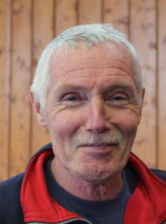
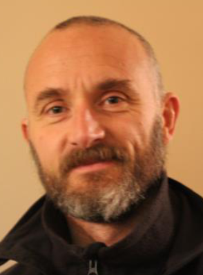
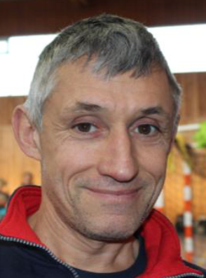
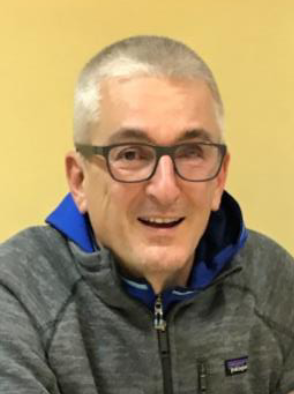

```{r setup, include=FALSE}
WORDS_TO_IGNORE <- c("guideascbalan", "ly")
source("knitr-options.R")
source("spelling-check.R")
source("runs.R")
source("courses.R")
```

# Introduction {-}

Bienvenue sur ce **guide du coureur**, un site conçu pour les membres de notre club de course, l'ASC Balan, quel que soit leur niveau ou leur expérience.
Ce guide vous aidera à comprendre les différents types d'entraînements, et comment progresser efficacement tout en minimisant les risques de blessures.

Le nouveau site de notre club se trouve [ici](https://balan-running.fr/).

Que vous vous entraîniez pour un 5 km, un 10 km, un semi-marathon, un marathon, un 24 heures, ou un trail, 
vous trouverez ici les principes fondamentaux et des conseils pratiques pour atteindre vos objectifs.

L'objectif est d'apprendre à structurer vos séances de manière intelligente,
en fonction de vos capacités et de vos ambitions, afin d'améliorer vos performances en course à pied.


## Mes performances {-}

Pour donner un exemple concret, voici mes progrès depuis que je suis au club :

```{r, echo=FALSE, out.width="100%"}
library(ggplot2)
ggplot(all, aes(date, vitesse, color = course, label = ville)) +
  theme_bw(12) + 
  geom_point(data = filter(all, !prevu), size = 3) + 
  geom_point(data = filter(all, prevu), size = 2.5, shape = 1, stroke = 1.2,
             show.legend = FALSE) + 
  geom_line(data = filter(all, !prevu), linewidth = 1) +
  geom_line(data = proj, aes(linetype = "Objectif"), linewidth = 1,
            show.legend = c(color = FALSE, linetype = TRUE)) +
  scale_linetype_manual(values = c(Objectif = "22"), name = NULL) +
  guides(color    = guide_legend(order = 1),
         linetype = guide_legend(override.aes = list(color = "black"))) +
  # geom_smooth() +
  scale_y_continuous(breaks = 1:25, minor_breaks = seq(1, 25, by = 0.2)) +
  scale_x_date(
    breaks = dmy(paste0("01/09/", 22:(year(today()) - 2000))),
    date_labels = "%d/%m/%y", 
    date_minor_breaks = "1 month",
    limits = c(dmy("01/09/22"), max(today(), all$date)),
    expand = expansion(mult = c(0.02, 0.03)),
    sec.axis = dup_axis(breaks = as.Date("1993-03-21") + years(30:100),
                        labels = paste(30:100, "ans"), name = NULL)
  ) +
  theme(legend.position = "top",
        legend.spacing.x = unit(0.6, "cm"),
        legend.text = element_text(margin = margin(l = 2.5, r = 5, unit = "pt")),
        panel.grid.major = element_line(color = "grey50", linewidth = 0.35),
        panel.grid.minor = element_line(color = "gray70", linewidth = 0.2),
        plot.margin = margin(t = 5, r = 20, b = 5, l = 5),
        legend.key.width = unit(1, "cm")) +
  labs(x = NULL, y = "Vitesse (km/h)", color = NULL)
```

A mettre en perspective avec mon volume hebdomadaire depuis que j'ai une montre :

```{r, echo=FALSE, out.width="100%", fig.asp = 0.5, warning=FALSE}
daily <- get_runs() %>%
  mutate(date = as_date(start)) %>%
  count(date, wt = km, name = "km") %>% 
  tidyr::complete(date = seq(min(date), today(), by = "day"), fill = list(km = 0)) %>%
  # trailing 28-day weighted mean, linearly decreasing weights (lag 0 first),
  # scaled so that a constant daily volume gives the right km per week
  mutate(
    km_sem   = as.numeric(stats::filter(km, 7 * (21:1) / sum(21:1), sides = 1)),
    # Gaussian smoothing (sd = 1 day, truncated at +/- 2 days) to remove day-to-day jaggedness
    km_sem_s = as.numeric(stats::filter(km_sem, dnorm(-2:2) / sum(dnorm(-2:2)), sides = 2))
  )

weekly <- daily %>%
  count(semaine = floor_date(date, "week", week_start = 1), wt = km, name = "km") %>%
  filter(semaine + 6 < today())  # drop current incomplete week


library(ggplot2)
ggplot() +
  theme_bw(12) +
  geom_vline(aes(xintercept = date), data = courses,
             linewidth = 0.6, linetype = "22", color = "chartreuse4") +
  geom_text(aes(date, Inf, label = nom), data = courses, angle = 35, color = "chartreuse4",
            hjust = 0, vjust = -0.5, size = 2.5, nudge_y = 1) +
  geom_line(aes(date, km_sem_s), data = daily, linewidth = 1, color = "#C77CFF", na.rm = TRUE) +
  geom_smooth(aes(semaine + 3.5, km), data = weekly, 
              method = "loess", span = 1.5, linetype = "22",
              formula = y ~ x, se = FALSE, color = "black", linewidth = 0.8) +
  scale_y_continuous(breaks = seq(0, 150, by = 10), limits = c(0, NA)) +
  scale_x_date(
    breaks = seq(dmy("01/09/24"), today(), by = "6 months"),
    date_labels = "%d/%m/%y",
    date_minor_breaks = "1 month",
    limits = c(dmy("01/09/24"), today()),
    expand = expansion(mult = c(0.02, 0.02))
  ) +
  coord_cartesian(clip = "off") +
  theme(panel.grid.major = element_line(color = "gray50", linewidth = 0.35),
        panel.grid.minor = element_line(color = "gray70", linewidth = 0.2),
        plot.margin = margin(t = 50, r = 30, b = 5, l = 5)) +
  labs(x = NULL, y = "Kms par semaine")
```


## Les entraîneurs {-}

Nous avons quatre entraîneurs au club :

<table style="table-layout: fixed; width: 100%;">
<thead>
<tr>
<th style="text-align: center; width: 25%;">Jean-Jacques</th>
<th style="text-align: center; width: 25%;">Lionel</th>
<th style="text-align: center; width: 25%;">Laurent</th>
<th style="text-align: center; width: 25%;">Frédéric</th>
</tr>
</thead>
<tbody>
<tr>
<td style="vertical-align: top; padding: 5px;">

</td>
<td style="vertical-align: top; padding: 5px;">

</td>
<td style="vertical-align: top; padding: 5px;">

</td>
<td style="vertical-align: top; padding: 5px;">

</td>
</tr>
</tbody>
</table>

**N'hésitez pas à demander des conseils et des plans d'entraînement personnalisés aux entraîneurs.**

Vincent et moi (Florian) sommes en cours de formation.


## Remerciements {-}

Merci aux entraîneurs pour leurs réponses à mes questions et leurs retours sur ce guide.
Merci aussi à Vincent R., Sylvie L., Sébastien D., Mélanie D. et Cécile G.. 
